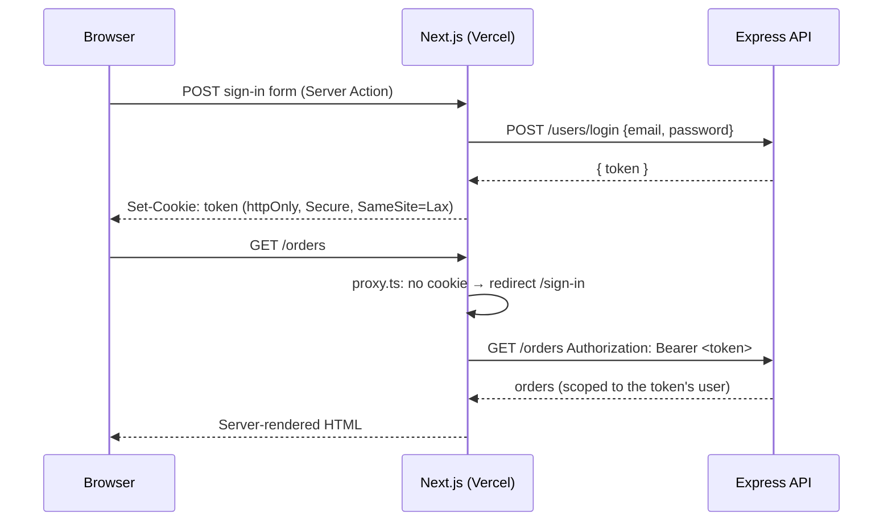

<div align="center">

# مخبز السنابل · Bakery Store

**An Arabic-first (RTL) bakery storefront with its own JWT auth, built on Next.js 16 Server Components
and Server Actions in front of an Express REST API.**


</div>

---

## Overview

**مخبز السنابل** (“The Wheat Ears Bakery”) is a full storefront for a bakery: browse breads and
pastries by category, save favorites, build a cart, place orders, and leave reviews. A complete
admin dashboard manages the catalogue.

Unlike a typical third-party-auth setup, this app runs its **own authentication flow**. The Express
backend issues a JWT, and Next.js stores it in an **`httpOnly`, `Secure`, `SameSite=Lax` cookie**
that client-side JavaScript can't read, so XSS can't steal the session.

## Features

| Area | What it does |
| --- | --- |
| 🥖 **Catalog** | Featured items, categories, debounced search, product detail with reviews |
| 🔑 **Auth** | Register / login / logout against the API. The JWT lives in an httpOnly cookie |
| ❤️ **Favorites** | Toggle per product, dedicated favorites page |
| 🛒 **Cart & orders** | Quantity control, server-computed totals, whole-cart or single-item orders |
| ⭐ **Reviews** | Rating and comment per product, plus a reviews overview page |
| 🧑‍🍳 **Admin** | Product & category CRUD with image upload. The backend checks `role === "ADMIN"` |
| 🎨 **UX** | Native RTL, dark mode, skeleton loaders, toast feedback, share buttons |

## Architecture



```
app/
├── (root)/        # storefront pages
├── (dashboard)/   # /admin (products, categories)
├── (auth)/        # sign-in / sign-up forms
utils/api.ts       # typed apiFetch<T>() + every Server Action, the single data gateway
proxy.ts           # gates /cart /favorites /orders /reviews /admin on the session cookie
```

## Security

- 🍪 **Session cookie hardening.** The cookie is `httpOnly`, `Secure` in production, `SameSite=Lax`, scoped to `/`, and its
  lifetime matches the JWT expiry.
- 🧾 **Explicit request bodies.** Register and login forward only `name` / `email` / `password` and never
  the raw form, so a crafted request can't smuggle extra fields such as `role`.
- 🧱 **Path-safe IDs.** Every ID placed in an API URL is `encodeURIComponent`-encoded.
- 🛡️ **HTTP security headers.** HSTS, `X-Frame-Options: DENY`, `nosniff`, `Referrer-Policy`,
  `Permissions-Policy`, and `X-Powered-By` removed.
- 🖼️ **Image allow-list.** The `localhost` image host only exists in development builds.
- 🔁 **Defense in depth.** The proxy redirects anonymous users early, and the backend re-verifies the token and role
  on every request.

## Getting started

```bash
git clone https://github.com/n1j10/bakery-store.git
cd bakery-store
npm install
cp .env.example .env.local
npm run dev        # http://localhost:3000 (expects the API on :5000)
```

| Variable | Required | Description |
| --- | :---: | --- |
| `API_URL` | ✅ | Express backend base URL incl. `/api` |
| `NEXT_PUBLIC_WEBSITE_URL` | ➖ | Canonical site URL for share links |

| Command | Purpose |
| --- | --- |
| `npm run dev` / `build` / `start` | Develop, build, serve |
| `npx tsc --noEmit` | Type-check |

## Tech stack

**Framework** Next.js 16 · React 19 · TypeScript · Server Actions
**UI** Tailwind CSS v4 · shadcn/ui · Base UI · Embla · Lucide · Sonner
**Validation** Zod 4
**Backend** Express REST API with JWT auth

Deployed on **Vercel**.

---

<div align="center">

Built by **[n1j10](https://github.com/n1j10)**

</div>
